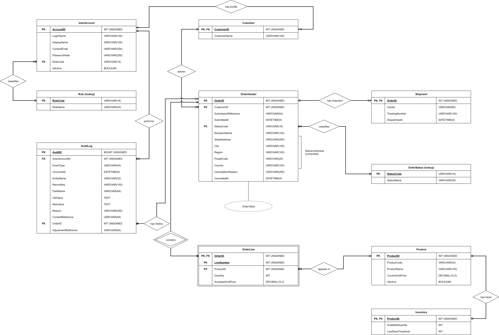

# Entity Relationship Diagram

## Purpose and notation

The ERD models 10 entities in one MySQL database. Tables show attributes, data types, underlined primary keys (PK), and foreign keys (FK). Named diamonds are used to identify relationships. The Crow's Foot symbols at the entity ends show the lowest and highest levels of participation. Double borders show a weak entity and its identifying relationship. The dashed oval is a derived attribute, and the bracket groups a composite attribute.

## Relationships

| Parent | Child | Children per parent | Parents per child |
| --- | --- | --- | --- |
| Role | UserAccount | 0..* | 1 |
| UserAccount | Customer | 0..1 | 1 |
| Customer | OrderHeader | 0..* | 1 |
| OrderStatus | OrderHeader | 0..* | 1 |
| OrderHeader | Shipment | 0..1 | 1 |
| OrderHeader | OrderLine | 1..* | 1 |
| Product | OrderLine | 0..* | 1 |
| Product | Inventory | 1 | 1 |
| UserAccount | AuditLog | 0..* | 1 |
| OrderHeader | AuditLog | 1..* | 0..1 |

## Keys and participation rules

- `Role` and `OrderStatus` are fixed lookup tables.
- The `OrderLine` is the weak associative entity that resolves the many-to-many relationship between the OrderHeader and the Product. Its primary key is OrderID and LineNumber; LineNumber is the partial key. The UNIQUE index on `(OrderID, ProductID)` makes sure that each product appears on only one line per order.
- The `Customer,` `Shipment,` and `Inventory` use the same parent keys. A CUSTOMER account has one customer profile. Other roles have none. An order has a shipment only when its status is SHIPPED. Each product has one inventory row.
- Each order that is accepted has at least one line and its required audit rows. Audit rows for operations that are not related to orders have a NULL OrderID. The system enforces required child rows and role/status conditions within the business transaction.
- Submission references are unique within each customer, and stock adjustment references are unique within the acting account. Each of these fields, `LoginName` and `ProductCode`, is unique.
- The `OrderValue` is calculated by adding up the `Quantity` times the `AcceptedUnitPrice` for each line on an order. The `Delivery Address` field groups together the following information: street address, city, region, postal code, and country. Neither label adds a stored column. Each order has a list of products, which are shown in order lines. Historical orders show the current product name while keeping the accepted prices and delivery details the same.
